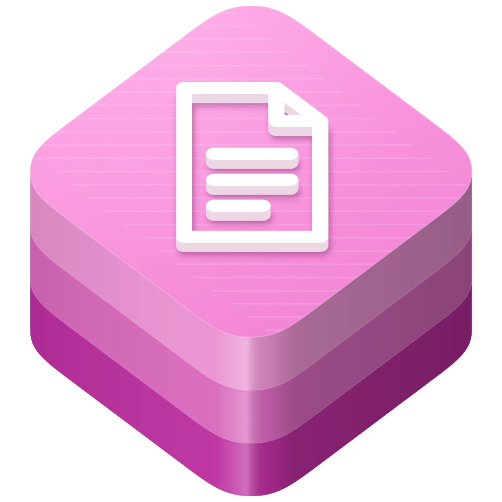

<div align="center">

<p align="center">
  <a href="https://github.com/swift-library/swift-pdf"></a>
</p>

<h1 align="center">swift-pdf</h1>

<p align="center">
  Build PDF viewers in SwiftUI with search, page overlays, and navigation driven by your controls.
</p>

<p align="center">
  <a href="https://github.com/swift-library/swift-pdf/actions/workflows/ci.yml"></a>
  
  
  <a href="LICENSE.txt"></a>
</p>

<p align="center">
  <a href="#overview">Overview</a> ·
  <a href="#quick-look">Quick look</a> ·
  <a href="#install">Install</a> ·
  <a href="#usage">Usage</a> ·
  <a href="#requirements">Requirements</a> ·
  <a href="#documentation">Documentation</a> ·
  <a href="#contributing">Contributing</a> ·
  <a href="#license">License</a>
</p>

</div>

## Overview

Keep the viewer’s state in sync with SwiftUI while your controls decide where to navigate. Search publishes matches without moving the document, and `PDFViewReader` gives controls a proxy for page commands; the [PDF guides](Sources/PDF/PDF.docc/PDF.md) cover overlays and state bindings.

## Quick look

```swift
import PDF
import PDFKit
import SwiftUI
@MainActor
func reader(for document: PDFDocument) -> some View {
  PDFViewReader { proxy in
    VStack {
      PDF(document: document).pdf.autoScales(true)
      Button("Next") { proxy.goToNextPage() }
    }
  }
}
```

## Install

Add the package and its `PDF` product to `Package.swift`:

```swift
dependencies: [
  .package(
    url: "https://github.com/swift-library/swift-pdf.git",
    .upToNextMinor(from: "0.1.0")
  ),
],
targets: [
  .target(
    name: "YourTarget",
    dependencies: [
      .product(name: "PDF", package: "swift-pdf"),
    ]
  ),
]
```

> [!NOTE]
> swift-pdf is pre-1.0. Minor releases may include source-breaking changes,
> so depend on it with `.upToNextMinor(from:)`.

## Usage

`PDF(source:)` accepts `.document`, `.data`, or `.fileURL`. Loading is handled
by PDFKit. Prepare a `PDFDocument` yourself when your interface needs to
handle a loading error before displaying the viewer.

Use `.pdf.displayDirection`, `.pdf.autoScales`, and `.pdf.isInMarkupMode` to
configure a viewer. Applying configuration to a parent view supplies defaults
for its descendant viewers.

Bind `.pdf.searchQuery` and `.pdf.searchOptions` to control a search. Observe
matches through `.pdf.searchResults`, `.pdf.searchResultCount`, and
`.pdf.searchResultIndex`; use the proxy to select a result. A query change
updates matches without automatically navigating.

Use `.pdf.overlay` to draw SwiftUI content on a page and `.pdf.overlayRelease`
to release associated resources when its overlay leaves the view lifecycle.

The [getting started](Sources/PDF/PDF.docc/GettingStarted.md),
[search](Sources/PDF/PDF.docc/SearchingDocuments.md), and
[page overlay](Sources/PDF/PDF.docc/PageOverlays.md) guides contain complete
examples and behavior details.

## Requirements

- Swift 6.3 or later (Xcode 26.6 or later).
- iOS 18+, macOS 15+, or visionOS 2+.
- SwiftUI and PDFKit; the package has no external package dependencies.

## Documentation

- [Architecture and lifecycle](Documentation/Architecture/Overview.md)
- [PDF module and API index](Sources/PDF/PDF.docc/PDF.md)
- [PDFViewer example](Examples/PDFViewer)
- [Release](Documentation/Reference/Release.md): release facts and mechanics; version rules are in VERSIONING.

## Contributing

See [Contributing](CONTRIBUTING.md) for local build, test, and formatting commands.

## License

[Apache-2.0 WITH Swift-exception](LICENSE.txt). See [NOTICE](NOTICE) for
source ownership and attribution.
